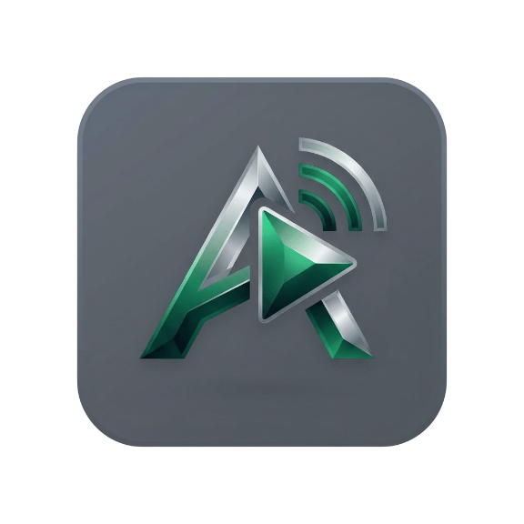

<p align="center">
<a href="https://imd-tv.com"></a>
</p>

<h1 align="center">IMD TV</h1>

<p align="center">
<b>Live TV, films and series on Android TV. One app.</b><br>
Free and open source, with no ads, accounts or tracking.
</p>

<p align="center">
<a href="https://github.com/majorleeevil/imd-tv/releases/latest"></a>
<a href="https://github.com/majorleeevil/imd-tv/releases"></a>
<a href="LICENSE"></a>

<a href="https://www.paypal.com/ncp/payment/VGKUKA7GNGEWA"></a>
</p>

<p align="center">
<b><a href="#get-imd-tv">Download</a></b> · <b><a href="https://imd-tv.com">Website</a></b> · <b><a href="#everything-inside">Everything inside</a></b> · <b><a href="https://github.com/majorleeevil/imd-tv/releases/latest">What's new</a></b>
</p>

<h3 align="center">On your TV: install Downloader from the Play Store and enter code <code>7573990</code></h3>

<p align="center"></p>

IMD TV plays your own IPTV playlist (Xtream login, M3U link, Stalker portal or Dispatcharr server), with your Plex, Jellyfin and Stremio
libraries alongside. It exists because few free IPTV apps offer a complete feature set without a licence, a
subscription or a paywall, and most open-source ones sit outside Android TV.

**Speed is the primary focus.** Watching TV, browsing the guide, switching channels and searching should be quick on
any box. Every screen is designed for the remote first, and it's tested on budget streaming sticks, not just high-end
boxes. Your logins stay encrypted on your box, and nothing about what you watch leaves it.

> [!IMPORTANT]
> **New in 0.7.1:** bug fixes. Plex no longer takes over Live TV, 4K movies from Plex and Jellyfin stop buffering, the
> TV guide and logos find more channels, follower sync carries hidden and renamed channels, and it installs on older Fire
> TV Sticks. [All the changes](https://github.com/majorleeevil/imd-tv/releases/tag/v0.7.1).
>
> **0.7.0** brought Plex, Jellyfin and Stremio next to your playlist, TV guide search, parental controls and more.
> [0.7.0 changes](https://github.com/majorleeevil/imd-tv/releases/tag/v0.7.0).

> [!NOTE]
> IMD TV is a media player. It does not provide, sell or link to any channels or content. Use the playlist you
> already have from your provider.

## Everything, one remote away

<table>
<tr>
<td width="50%" valign="top">

### Keep watching while you browse

Leave full screen and the channel carries on in the guide's **preview** while you look for what's next. Opens on the **last channel** you watched, and plays **Dolby and DTS** on any box.

</td>
<td width="50%" valign="top">

### A guide that fills itself in

**Seven days** of programmes, with **free open-source guides** for the channels your provider leaves blank. Choose the **guide priority**, borrow guides from similar channels, add your own sources.

</td>
</tr>
<tr>
<td width="50%" valign="top">

### Your channels, your way

**Favourites**, categories of your own, **hide** what you never watch, **sort** A–Z or your own order, your own **channel numbers**, and **merge** HD, 4K and RAW duplicates into one.

</td>
<td width="50%" valign="top">

### Movies, series and media servers

Posters, seasons and episodes, **resume** where you left off. Your **Plex**, **Jellyfin** and **Stremio** libraries sit alongside, with **Continue watching** that syncs both ways.

</td>
</tr>
<tr>
<td width="50%" valign="top">

### Search everything

One search for **channels, films, series and TV guide programmes**. Watch what's on now in one press, or **record** a later programme.

</td>
<td width="50%" valign="top">

### Record live TV

Record **now** or **schedule** from the guide, to the box, a **USB drive** or a **network share**. Starts early, ends late, and keeps the box awake.

</td>
</tr>
<tr>
<td width="50%" valign="top">

### Parental controls

A **PIN** and backup word. Lock by **rating**, by **category** or by **channel**, and choose how long an unlock lasts.

</td>
<td width="50%" valign="top">

### Six themes

**Celestial Glass**, **Celestial +**, **Celestial Retro**, **Liquid Glass**, **Xcube 360** and **Gamestation**: each changes the whole app, not just its colours.

</td>
</tr>
</table>

## See it

<table>
<tr>
<td width="50%" align="center"><br><sub>Keep watching in the guide's preview</sub></td>
<td width="50%" align="center"><br><sub>Movies with a Jellyfin section in the rail</sub></td>
</tr>
<tr>
<td width="50%" align="center"><br><sub>Continue watching across playlists and servers</sub></td>
<td width="50%" align="center"><br><sub>Search the TV guide: on now and later</sub></td>
</tr>
<tr>
<td width="50%" align="center"><br><sub>Hold OK on a channel for its menu</sub></td>
<td width="50%" align="center"><br><sub>Sort a category: playlist, A–Z or your own order</sub></td>
</tr>
<tr>
<td width="50%" align="center"><br><sub>Recordings</sub></td>
<td width="50%" align="center"><br><sub>A child-locked channel</sub></td>
</tr>
<tr>
<td width="50%" align="center"><br><sub>Movie details</sub></td>
<td width="50%" align="center"><br><sub>Add a playlist from your phone</sub></td>
</tr>
</table>

Six themes, all with the same fast guide:

<table>
<tr>
<td width="50%" align="center"><br><sub>Celestial Glass</sub></td>
<td width="50%" align="center"><br><sub>Celestial +</sub></td>
</tr>
<tr>
<td width="50%" align="center"><br><sub>Celestial Retro</sub></td>
<td width="50%" align="center"><br><sub>Liquid Glass</sub></td>
</tr>
<tr>
<td width="50%" align="center"><br><sub>Xcube 360</sub></td>
<td width="50%" align="center"><br><sub>Gamestation</sub></td>
</tr>
</table>

## Everything inside

<details open>
<summary><b>And all of this, free</b></summary>

- Your Plex and Jellyfin libraries, and the movie and series catalogs of your Stremio add-ons, next to your playlist's. Sign in with a code, pick the libraries, and later updates fetch only what changed
- Continue watching that works both ways with Plex, Jellyfin and Stremio: start a film here and finish it in the app on your phone
- One Favourites list and one Continue watching for every playlist and media server you use
- Parental controls: a PIN and backup word, locks by rating, by category or by channel, and you choose how long an unlock lasts
- Add or edit a playlist from your phone: scan the QR code on the TV and type the login there. Your passwords are never sent to the phone
- Search the TV guide: programmes on now and later, then watch or record in one press
- Sort channels by the playlist's order, A–Z or your own order, and give channels your own numbers
- Show channels by name, by logo or both, and pick the text size that suits your TV
- Sort movies and series by the playlist's order, A–Z or recently added
- Playlists and media servers update in the background, every 6, 12, 24 or 48 hours
- Channel and Page Up/Down move a whole screen at a time; hold Back in the guide for the other Back action, or go full screen on its own after a few minutes
- The ability to add several playlists, not just one. Choose between Xtream logins, M3U links, Stalker portals (beta) and Dispatcharr servers (sign in with your Dispatcharr login or API key), give each your own name, and use several at once: their categories sit together in one list
- Merge duplicate channels: HD, 4K and RAW copies of a channel become one, playing the best version – within each category or across them, and only for the playlists you choose
- Catch-up TV: watch programmes that have already aired, on channels where your provider keeps them, or restart the one that's on
- English, French, Spanish, Polish, Dutch, German, Italian, Portuguese, Turkish, Romanian, Greek, Swedish and Albanian
- Channel logos from open-source sets, your playlist, the TV guide or your own logo pack. You choose which source channels use first, second or third
- The ability to record shows to local storage, external storage or network storage
- Backup and restore, with logins never written to the file
- Sync between the boxes in your home: set one as the master and the others copy its playlists, logins and settings each time IMD TV opens and every 6 hours. Pair each box once with a code
- Live TV, Movies and Series switches for each playlist, so you only load what you watch
- The ability to start the application when your TV box starts
- DRM channels: M3U channels protected with ClearKey or Widevine play too
- Recently watched channels, one press away
- An open-source guide, built in – if you want it. No more creating your own guides
- The ability to choose the priority of EPGs: the open-source guide, your playlist's guide or EPG sources you add yourself. You decide
- Keep up to 14 days of guide, past and upcoming
- Plays HLS, DASH and MPEG-TS streams, with a custom user agent per playlist if your provider needs one
- Subtitles on live TV, when the channel has them
- Change channel with Up/Down or Left/Right, and step back through the channels you watched
- Aspect ratio in the player: Auto, 16:9, 4:3 or Fill
- An on-screen clock, 12- or 24-hour and also while you watch, and an optional connection ping
- One-click updates, with a short “what's new” after each one

</details>

### Set it up your way

<details>
<summary><b>Playlists</b></summary>

<table>
<tr>
<td width="50%" align="center"><br><sub>Settings, Playlists: the list of playlists, with iptv-org.github.io in use</sub></td>
<td width="50%" align="center"><br><sub>Settings, Playlists: the Add playlist form</sub></td>
</tr>
<tr>
<td width="50%" align="center"><br><sub>Settings, a playlist's page: Use this playlist and switches for Live TV, Movies and Series</sub></td>
<td width="50%"></td>
</tr>
</table>

</details>

<details>
<summary><b>Media servers</b></summary>

<table>
<tr>
<td width="50%" align="center"><br><sub>Settings, Media servers: Plex, Jellyfin, Stremio and update playlists every</sub></td>
<td width="50%" align="center"><br><sub>Add Plex server: a code to enter at plex.tv/link, and a QR code</sub></td>
</tr>
<tr>
<td width="50%" align="center"><br><sub>Add Jellyfin server: type the server address, for example http://192.168.1.10:8096</sub></td>
<td width="50%" align="center"><br><sub>Add Jellyfin server: a Quick Connect code, or sign in with username and password</sub></td>
</tr>
<tr>
<td width="50%" align="center"><br><sub>Jellyfin: choose the libraries to load from the server</sub></td>
<td width="50%" align="center"><br><sub>Add Stremio account: a code to enter at link.stremio.com, and a QR code</sub></td>
</tr>
</table>

</details>

<details>
<summary><b>TV guide</b></summary>

<table>
<tr>
<td width="50%" align="center"><br><sub>Settings, TV guide: update now, guide sources, three guide priorities and borrow guide from similar channels</sub></td>
<td width="50%" align="center"><br><sub>Settings, TV guide: clear guide data, update every, update on start, update on playlist change, days to keep and past days to keep</sub></td>
</tr>
</table>

</details>

<details>
<summary><b>Channels and categories</b></summary>

<table>
<tr>
<td width="50%" align="center"><br><sub>Settings, Channels: manage channels, merge channels, merge options, channel logos and channel name clean-up</sub></td>
<td width="50%" align="center"><br><sub>Settings, Channels: remove special characters, hide header channels, channel numbers and channel display</sub></td>
</tr>
<tr>
<td width="50%" align="center"><br><sub>Settings, Merge options: merge across, merge by and playlists</sub></td>
<td width="50%" align="center"><br><sub>Settings, Categories: languages, your categories, manage provider categories, category name clean-up and a Recently watched switch</sub></td>
</tr>
<tr>
<td width="50%" align="center"><br><sub>Manage provider categories: each Live category with its channel count, a show or hide switch and hold OK to move</sub></td>
<td width="50%"></td>
</tr>
</table>

</details>

<details>
<summary><b>Playback, recording, movies and series</b></summary>

<table>
<tr>
<td width="50%" align="center"><br><sub>Settings, Playback: autoplay, audio decoder, change channel with and view previous channel</sub></td>
<td width="50%" align="center"><br><sub>Settings, Playback: recording, catch-up and subtitles</sub></td>
</tr>
<tr>
<td width="50%" align="center"><br><sub>Settings, Recording: recording switch, save to, free space, start early, end late and keep the box awake</sub></td>
<td width="50%" align="center"><br><sub>Settings, Movies and Series: Sort by Playlist, Alphabetical or Recently added</sub></td>
</tr>
</table>

</details>

<details>
<summary><b>Appearance and app behaviour</b></summary>

<table>
<tr>
<td width="50%" align="center"><br><sub>Settings, Appearance: App, Live TV and Movies and Series</sub></td>
<td width="50%" align="center"><br><sub>Settings, Appearance, App: theme, theme colour, theme mode, date and time, and reset</sub></td>
</tr>
<tr>
<td width="50%" align="center"><br><sub>Settings, Appearance, Live TV: the Text sizing choices Large, Medium and Small</sub></td>
<td width="50%" align="center"><br><sub>Settings, App behaviour: last channel on start, Back in TV guide, hold Back in TV guide, full screen after, language, parental controls and confirm exit</sub></td>
</tr>
</table>

</details>

<details>
<summary><b>Parental controls</b></summary>

<table>
<tr>
<td width="50%" align="center"><br><sub>Settings, Parental controls: on, lock content rated 12A and up, ask for the PIN until the app closes, change PIN</sub></td>
<td width="50%"></td>
</tr>
</table>

</details>

<details>
<summary><b>Backup and sync</b></summary>

<table>
<tr>
<td width="50%" align="center"><br><sub>Settings, Backup and restore</sub></td>
<td width="50%" align="center"><br><sub>Settings, Sync: this box is the master and has no followers</sub></td>
</tr>
<tr>
<td width="50%" align="center"><br><sub>Settings, Sync: this box is a follower, looking for a master on the network</sub></td>
<td width="50%"></td>
</tr>
</table>

</details>

## Get IMD TV

| Platform | Get it | Notes |
|---|---|---|
| Android TV / Google TV | Downloader code `7573990` | Install the free Downloader app from the Play Store, enter the code, allow installs. |
| Android TV / Google TV | [imd-tv.apk](https://github.com/majorleeevil/imd-tv/releases/latest/download/imd-tv.apk) | Always the newest version. Sideload with adb or a USB drive. |
| All versions | [Releases](https://github.com/majorleeevil/imd-tv/releases) | Every version with its change notes. |

<details>
<summary><b>Step-by-step install</b></summary>

Requires Android TV / Google TV **7.1 or newer**, or a Fire TV on Fire OS 6 or newer. Tested on Chromecast with Google TV and a Thomson 140 stick.

### Option 1: Downloader (on the TV)

1. On your TV, install the free **Downloader** app from the Play Store.
2. Open Downloader, type the code `7573990` and press Go. When asked, allow Downloader to install apps, then choose Install.
3. Open IMD TV and add your Xtream login, M3U link or Stalker portal.

### Option 2: Sideloading (from a computer)

1. Download `imd-tv.apk` from [Releases](https://github.com/majorleeevil/imd-tv/releases) on your computer.
2. On the TV, turn on Developer options and USB or network debugging, then run `adb connect <your TV's IP>` and
   `adb install imd-tv.apk`. Or copy the file to a USB drive and open it with a file manager app on the TV.
3. Open IMD TV and add your Xtream login, M3U link or Stalker portal.

</details>

## Known limitations

<details>
<summary><b>Media servers</b></summary>

- Plex, Jellyfin and Stremio aren't in backup files. After restoring a backup, add them again under Settings › Media servers.
- The first add of a very large server downloads the whole library and can take 10 minutes or more on a busy shared
  server. Later updates fetch only what changed.

</details>

<details>
<summary><b>Stremio</b></summary>

- Only direct links (http/https) play. Torrent streams would need a torrent engine, which the app doesn't have, so a title
  whose add-ons offer only torrents can't be played.
- No stream picker: the first direct link the add-ons give is played, in your Stremio account's add-on order.
- Each catalog is capped at 500 titles, and Continue watching shows only titles in the catalogs you picked.

</details>

<details>
<summary><b>Recording</b></summary>

- A box in deep standby may not wake for a scheduled recording; it is then marked "Missed". If the box wakes while the
  programme is still on, the rest is recorded.
- Recording one channel while watching another needs two connections from your provider. Xtream logins report their
  limit and the app asks before it stops one; with M3U playlists and Stalker portals the app just tries, and the recording fails if the
  provider refuses a second stream. (Recording the channel you're watching needs two connections too.)
- Internal storage on small boxes holds only a few hours (a Chromecast with Google TV: about 2 hours of HD). Use a USB
  drive or a network share.
- Recordings on the box or a USB drive are removed if you uninstall the app (they live in the app's own folder; on a
  USB drive that's `Android/data/org.imdtv.iptvtv/files/Recordings`). Network-share recordings stay.
- DASH and encrypted streams can't be recorded. Recordings are saved as received (`.ts`), not converted.
- No live pause and no series recording.

</details>

## Free forever, private by default

IMD TV is free and always will be. No accounts, no ads, no analytics, and logins are encrypted on the device. If it's
useful to you, you can [buy me a coffee](https://www.paypal.com/ncp/payment/VGKUKA7GNGEWA), entirely optional.

Questions or problems: support@imd-tv.com or [GitHub issues](https://github.com/majorleeevil/imd-tv/issues).

## For developers

<details>
<summary><b>Build from source</b></summary>

You need JDK 17 and the Android SDK (platform 35), or Android Studio.

```sh
./gradlew assembleRelease   # app/build/outputs/apk/release/app-release.apk
./gradlew testDebugUnitTest # unit tests
```

Release builds are signed with the key described in `~/.config/iptv-tv/keystore.properties` (path overridable with
`IPTV_KEYSTORE_PROPERTIES`); without it they fall back to the debug key.

</details>

## Licence

[GPL-3.0](LICENSE). You may use, study, change and share IMD TV; shared changes must stay under the same licence.
